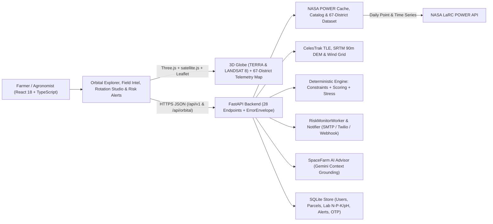

<div align="center">

# Space Farm

**From Space Data to Smarter Farms**  
*Built by **Team CODE44** for the **2026 NASA Space Apps Challenge — Adapting Farms with NASA Data** (`Ganja / Azerbaijan`)*

[](https://www.spaceappschallenge.org/2026/challenges/adapting-farms-with-nasa-data/)
[](https://spacefarm-gov.vercel.app)
[](services/api/app/main.py)
[](apps/web/package.json)
[](apps/web/src/data/azDistricts.ts)
[](LICENSE)

</div>

---

## 1. Executive Summary

**Space Farm** is a full-stack, bilingual (**AZ / EN**) precision-agriculture and climate-adaptation platform that transforms open **NASA Earth Observation** datasets into actionable, explainable farm decisions for Azerbaijani farmers and agronomists.

Unlike opaque black-box predictors or synthetic mockups, every climate calculation, terrain metric, alert threshold, and 3-year crop rotation plan in Space Farm traces back to verifiable **NASA LaRC POWER**, **NASA TERRA / USGS LANDSAT 8** orbital feeds, **SRTM / Copernicus 90m DEM** elevation, and transparent FAO-aligned agronomic constraints:

- **Explicit Uncertainty First:** Unmeasured soil laboratory fields stay `null` / `unknown` (`provisional`) rather than silently defaulting to `pH 7.0`.
- **Constraint-Filtered Rotation Planning:** Eliminates agronomically unsafe or water-infeasible sequences *before* deterministic scoring across up to 3 distinct **3-year crop rotations**.
- **Stress Replay Without Data Mutation:** Simulates `0.9x`, `0.8x`, and `0.7x` rainfall-stress scenarios against historical NASA baselines with full metric deltas.
- **Nationwide 67-District Telemetry:** Interactive 3D orbital globe and 2D Esri / NASA GIBS satellite explorer covering all **67 Azerbaijan districts** plus **4 deep-verified regional 2024 snapshots**.

---

## 2. NASA & Earth Observation Data Pipeline

| Data Source | Provider / Dataset | Resolution / Standard | Purpose in Space Farm |
|---|---|---|---|
| **Climate & Soil Moisture** | [NASA LaRC POWER Daily API](https://power.larc.nasa.gov/docs/services/api/temporal/daily/) (`v2.10.3`) | Daily (`AG` community, `UTC`, `0.5° × 0.625°` MERRA-2 grid) | Historical precipitation (`PRECTOTCORR`), mean/min/max air temp (`T2M`, `T2M_MIN`, `T2M_MAX`), root-zone & surface soil wetness (`GWETROOT`, `GWETTOP`), relative humidity (`RH2M`), solar irradiance (`ALLSKY_SFC_SW_DWN`) |
| **Multi-Year Climate Trends** | NASA POWER Interannual Time Series | 10-year daily-to-annual series (`/api/v1/climate/timeseries`) | Long-term drought, frost, heatwave, and precipitation volatility diagnostics per selected district or coordinate |
| **Orbital Pass Tracking** | CelesTrak SGP4 TLEs (`satellite.js`) | Real-time SGP4 propagation | Live 3D orbital trajectories & satellite camera alignment for **NASA TERRA (NORAD 25994)** and **NASA/USGS LANDSAT 8 (NORAD 39084)** |
| **Satellite Base Maps & Terrain** | Esri World Imagery, NASA GIBS WMTS & SRTM / Copernicus DEM | 90m DEM (`/api/orbital/elevation`) + Global imagery tiles | Interactive parcel pin selection, terrain elevation readout (`m a.s.l.`), and MERRA-2 grid cell footprint visualization |
| **7-Day Agricultural Hazards** | Open-Meteo Forecast + NASA `GWETROOT` baseline | Hourly / 7-day rolling window (`/api/v1/alerts/*`) | Automated frost, drought, extreme heat, and heavy-rainfall risk scoring with cooldown-guarded Email/SMS alerts |

### Verified 2024 Azerbaijan Regional Baseline Snapshots (`SHA-256` Audited)

All 4 primary agricultural zone baselines contain `366/366` valid leap-year days (`2024-01-01` to `2024-12-31`) stored with query-keyed manifests under `data/raw/` and `data/processed/` and audited independently by `tools/data/audit_data.py`:

| Primary Zone | Coordinates | Query Hash | Annual Precip | Mean Temp | Manifest Verification |
|---|---|---|---|---|---|
| **Ganja–Dashkasan** (`Ganja`) | `40.68°N, 46.36°E` | `552e40e213b9f7b8` | `506.52 mm` | `10.58 °C` | `SHA-256` verified (`366/366` days) |
| **Aran** (`Barda–Yevlakh`) | `40.38°N, 47.12°E` | `a56184dd09acd946` | `457.50 mm` | `15.70 °C` | `SHA-256` verified (`366/366` days) |
| **Quba–Khachmaz** (`Quba`) | `41.36°N, 48.51°E` | `f850af6ab056dbf6` | `516.20 mm` | `15.04 °C` | `SHA-256` verified (`366/366` days) |
| **Shaki–Zagatala** (`Shaki`) | `41.19°N, 47.17°E` | `3f72f4396abc697d` | `588.52 mm` | `15.65 °C` | `SHA-256` verified (`366/366` days) |

---

## 3. System Architecture



### Core Platform Modules

| Frontend View (`apps/web/src/pages/`) | Backend Responsibility (`services/api/app/`) | Key Capabilities |
|---|---|---|
| `HomePage.tsx` | Public status & catalog (`/api/v1/health`, `/crops`) | Bilingual landing walkthrough, live NASA telemetry showcase, Typewriter + SpiderWeb cosmic hero |
| `AuthPage.tsx` | `workspace_api.py` (`/api/v1/auth/*`) | Password auth, 4-digit Email OTP signup, 6-digit password reset, and Google Identity Services OAuth |
| `OrbitalExplorerPage.tsx` | `routes/orbital.py` + `OrbitalEarthModule` | Interactive 3D orbital satellite camera + 2D 67-district Esri imagery selector feeding coordinate/area directly into planning |
| `FieldIntelligencePage.tsx` | `workspace_api.py` + `sqlite_store.py` | Multi-parcel manager, laboratory soil panel (`pH`, `OM%`, `N`, `P`, `K`, `EC`, moisture, texture), `null` uncertainty preservation |
| `RotationStudioPage.tsx` | `engine/constraints.py`, `scoring.py`, `planner.py` | 6 candidate crops (`wheat`, `barley`, `chickpea`, `lentil`, `sunflower`, `maize`) across 7 FAO Paper 56 / CROPWAT rules |
| `ClimateHistoryPage.tsx` | `data_adapters/provider.py` + `nasa_power.py` | Multi-year precipitation/temperature anomaly charts and provenance SHA-256 inspector |
| `ScenarioLabPage.tsx` | `engine/planner.py` | Side-by-side rainfall stress simulation (`0.9x`, `0.8x`, `0.7x`) without altering baseline observations |
| `RiskAlertsPage.tsx` | `workers/risk_monitor.py` + `engine/risk_analyzer.py` + `notifier.py` | Frost, drought, heat & storm risk matrix, automated periodic scanning, Email (`STARTTLS`/`SMTP_SSL`) + SMS alert delivery |
| `SpaceFarmAiPage.tsx` | `engine/ai_advisor.py` | Context-aware Gemini AI agronomist referencing the farmer's live parcel, lab soil profile, and weather alerts |
| `ProfilePage.tsx` & `SourcesExplanationsPage.tsx` | `/api/v1/profile`, `/api/v1/crops` | Full account settings, alert channel verification, methodology disclosures, and data provenance |

---

## 4. Repository Structure

```text
space-farm/
├── README.md
├── LICENSE                            # MIT License (code only; NASA open data terms preserved separately)
├── vercel.json                        # Full-stack Vercel routing (Vite SPA + FastAPI serverless API)
├── requirements.txt                   # Root Python runtime dependencies for serverless deployment
├── .env.example                       # Safe configuration template (no secrets committed)
├── api/
│   └── index.py                       # Vercel ASGI bridge exposing FastAPI app
├── apps/
│   └── web/                           # React 18 + TypeScript + Vite + Three.js + Leaflet frontend
│       ├── vite.config.ts             # Vite build & /api proxy (reads root .env via envDir)
│       └── src/
│           ├── api/                   # Typed API clients (client.ts, extendedClient.ts, types.ts)
│           ├── data/azDistricts.ts    # 67 verified Azerbaijan district records + NASA metrics
│           ├── modules/orbital-earth/ # Interactive 3D orbital Earth + 2D Leaflet satellite map
│           └── pages/                 # 11 modular bilingual application & landing views
├── services/
│   └── api/
│       ├── app/
│       │   ├── config.py              # Pydantic settings + serverless /tmp runtime safety
│       │   ├── main.py                # FastAPI entrypoint, CORS & standard ErrorEnvelope
│       │   ├── routes/                # v1 contract (api.py), orbital telemetry (orbital.py), workspace/auth (workspace_api.py)
│       │   ├── data_adapters/         # NASA POWER async client, SHA-256 query cache, 67-district registry
│       │   ├── engine/                # Agronomic constraints, deterministic scoring, risk analyzer, AI advisor
│       │   ├── services/notifier.py   # SMTP (465 SSL / 587 STARTTLS) & Twilio/Webhook SMS dispatcher
│       │   ├── storage/sqlite_store.py# Persistent accounts, parcels, lab soil records, OTP/reset codes, alerts
│       │   └── workers/risk_monitor.py# Background asyncio hazard scan scheduler
│       └── tests/                     # Automated unit, contract, auth & district test suites
├── data/
│   ├── raw/ & processed/              # 4 SHA-256 audited Azerbaijan 2024 NASA POWER baselines
│   └── catalog/                       # crops.json (6 crops) & rules.json (7 agronomic rules)
├── contracts/                         # Frozen v0.1.0 OpenAPI schema & contract fixtures
├── tools/
│   ├── data/fetch_power.py            # CLI tool to fetch & manifest NASA POWER snapshots
│   ├── data/audit_data.py             # Integrity verifier for crops, rules, snapshots & fixtures
│   └── contracts/generate_contracts.py
├── tests/e2e/verify_live_e2e.py       # Live NASA POWER -> API simulation E2E check
└── infra/                             # Dockerfile.api, docker-compose.yml & CI workflow
```

---

## 5. Local Quickstart

### Prerequisites
* **Python 3.11 or 3.12** (tested on `Python 3.12.2`)
* **Node.js 20+ & npm** (tested on `Node.js 24.18.0`)

### 1. Configure Environment Variables
```bash
cp .env.example .env
```
Populate the optional keys in `.env` according to what features you want enabled:
* `GEMINI_API_KEY`: Enables live Gemini responses inside **SpaceFarm AI**.
* `SMTP_HOST`, `SMTP_PORT`, `SMTP_USER`, `SMTP_PASSWORD`, `SMTP_FROM_EMAIL`: Enables live outbound email for 4-digit OTP signup, 6-digit password reset, and weather risk alerts (for Gmail SMTP, use a **16-character Gmail App Password** with `smtp.gmail.com:587`).
* `GOOGLE_CLIENT_ID` & `VITE_GOOGLE_CLIENT_ID`: Enables live **Continue with Google** popup authentication.

> **Note:** **NASA LaRC POWER**, **SRTM 90m DEM**, and **CelesTrak TLE** integrations work immediately with **zero external API keys**.

### 2. Start Backend API (`services/api`)
```bash
pip install -e services/api --no-build-isolation
python -m uvicorn app.main:app --app-dir services/api --host 127.0.0.1 --port 8000 --reload
```
Health check: `http://127.0.0.1:8000/api/v1/health` · OpenAPI docs: `http://127.0.0.1:8000/docs`

### 3. Start Frontend Web App (`apps/web`)
```bash
cd apps/web
npm install
npm run dev -- --host 127.0.0.1 --port 5173
```
Open `http://127.0.0.1:5173`. Vite proxies `/api/*` requests directly to `127.0.0.1:8000`.

---

## 6. Verification & Automated Testing

```bash
# 1. Audit NASA POWER snapshots, SHA-256 manifests, crops, rules & contracts
python tools/data/audit_data.py

# 2. Run backend unit, engine, auth & API test suites
python -m unittest discover -s services/api/tests -t services/api -v

# 3. Verify live NASA POWER end-to-end fetch -> deterministic simulation
python -m unittest tests/e2e/verify_live_e2e.py -v

# 4. Type-check & build production frontend bundle
cd apps/web && npm run build
```

---

## 7. Vercel Deployment

Live production URL: **[`https://spacefarm-gov.vercel.app`](https://spacefarm-gov.vercel.app)**

Space Farm ships with root [`vercel.json`](vercel.json), [`api/index.py`](api/index.py), and [`requirements.txt`](requirements.txt) configured for unified deployment on Vercel:
- Static React/Vite bundle is built from `apps/web` into `apps/web/dist`.
- All `/api/*` traffic routes cleanly to the serverless FastAPI ASGI entrypoint (`api/index.py`).
- On read-only serverless runtimes (`VERCEL=1`), `config.py` routes dynamic SQLite & runtime cache writes to `/tmp/spacefarm-data` while reading bundled `data/raw`, `data/processed`, and `data/catalog` datasets directly from the deployment bundle *(for persistent multi-user production storage beyond demo/serverless sessions, connect an external managed database).*

---

## 8. License & Data Attribution (Separated)

1. **Software Source Code — MIT License:** Original source code and documentation authored by **Team CODE44** are licensed under the [MIT License](LICENSE).
2. **NASA Open Data Attribution:** **NASA LaRC POWER**, **NASA GIBS**, and **NASA TERRA / USGS LANDSAT 8** telemetry remain governed by their respective open science policies and require source attribution without implying official NASA endorsement.
3. **Agronomic References:** Crop thresholds follow FAO Guidelines ([Irrigation & Drainage Paper 56](https://www.fao.org/4/x0490e/x0490e00.htm), [CROPWAT](https://www.fao.org/land-water/databases-and-software/cropwat/en/)) and are documented in [`data/catalog/crops.json`](data/catalog/crops.json) and [`docs/SOURCES.md`](docs/SOURCES.md).
